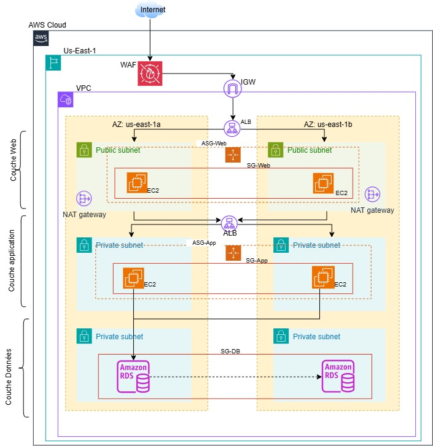

# 3-tiers-architecture

Infrastructure AWS en architecture 3-tiers (web, applicatif, données), entièrement décrite et déployée en Infrastructure as Code avec Terraform.

L'objectif est de fournir une infrastructure **hautement disponible**, **sécurisée** et **reproductible**, répartie sur deux zones de disponibilité (AZ), avec une séparation stricte des niveaux réseau, une protection applicative par pare-feu web (WAF) et une base de données relationnelle résiliente.

---

## Architecture



L'infrastructure est déployée dans la région `us-east-1`, sur deux zones de disponibilité (`us-east-1a` et `us-east-1b`) :

| Couche          | Sous-réseaux (AZ a / AZ b)       | Composants |
|-----------------|----------------------------------|------------|
| **Web**         | Publics `10.0.1.0/24` / `10.0.2.0/24`    | WAF + ALB public, ASG web (EC2 Apache), une NAT Gateway par AZ |
| **Application** | Privés `10.0.11.0/24` / `10.0.12.0/24`   | ALB interne, ASG applicatif (EC2) |
| **Données**     | Privés `10.0.21.0/24` / `10.0.22.0/24`   | Amazon RDS MySQL Multi-AZ (primaire + standby répliqué) |

### Flux autorisés (Security Groups en cascade)

| Source           | Destination      | Port      |
|------------------|------------------|-----------|
| Internet         | ALB public       | 80, 443   |
| ALB public       | Instances web    | 80        |
| Instances web    | ALB interne      | 8080      |
| ALB interne      | Instances app    | 8080      |
| Instances app    | RDS MySQL        | 3306      |

Chaque niveau n'accepte du trafic **que** depuis le Security Group du niveau précédent.

---

## Organisation du code

| Fichier         | Contenu |
|-----------------|---------|
| `providers.tf`  | Version Terraform/provider AWS, tags par défaut, data sources (AZ, région, AMI via SSM) |
| `variables.tf`  | Toutes les variables paramétrables (CIDR, tailles d'instances, capacités, WAF, BDD) |
| `network.tf`    | VPC, Internet Gateway, 6 sous-réseaux, 2 NAT Gateways (une par AZ), tables de routage |
| `security.tf`   | Security Groups, WAFv2 Web ACL, journalisation WAF (CloudWatch Logs), alarme CloudWatch |
| `web-tier.tf`   | ALB public, target group, launch template, Auto Scaling Group web, association WAF |
| `app-tier.tf`   | ALB interne, target group (`/health`), launch template, Auto Scaling Group applicatif |
| `database.tf`   | Subnet group et instance RDS MySQL (Multi-AZ, chiffrée, sauvegardes 7 jours) |
| `outputs.tf`    | IDs réseau, ARN du WAF, DNS des ALB, endpoint de la BDD |

---

## Prérequis

- [Terraform](https://developer.hashicorp.com/terraform/install) **>= 1.5.0**
- Provider AWS `~> 5.0` (installé automatiquement par `terraform init`)
- Un compte AWS et des identifiants configurés (`aws configure`, variables d'environnement ou profil)
- Droits IAM suffisants pour créer : VPC, EC2/ASG, ELB, WAFv2, CloudWatch, RDS

---

## Déploiement

1. **Initialiser le projet**

   ```bash
   terraform init
   ```

2. **Fournir le mot de passe de la base de données** (obligatoire, 8 caractères minimum). Ne le commitez jamais ; utilisez par exemple une variable d'environnement :

   ```bash
   export TF_VAR_db_password='un-mot-de-passe-solide'
   ```

   ou un fichier `terraform.tfvars` (ignoré par Git) :

   ```hcl
   db_password      = "un-mot-de-passe-solide"
   environment_name = "dev"
   aws_region       = "eu-west-3"
   ```

3. **Vérifier puis appliquer le plan**

   ```bash
   terraform plan -out tfplan
   terraform apply tfplan
   ```

4. **Récupérer l'URL de l'application**

   ```bash
   terraform output web_alb_dns_name
   ```

### Destruction

```bash
terraform destroy
```

Un snapshot final de la base (`<environment_name>-db-final-snapshot`) est créé à la suppression. Pensez à le supprimer manuellement s'il n'est plus utile, et sachez qu'un second `destroy`/`apply` avec le même nom échouera tant que ce snapshot existe.

---

## Variables principales

| Variable                | Défaut        | Description |
|-------------------------|---------------|-------------|
| `aws_region`            | `us-east-1`   | Région AWS de déploiement |
| `environment_name`      | `prod`        | Préfixe de nommage et tag `Environment` |
| `vpc_cidr`              | `10.0.0.0/16` | Plage CIDR du VPC |
| `web_instance_type`     | `t3.micro`    | Type d'instance du niveau web |
| `web_min_size` / `web_max_size` / `web_desired_capacity` | `2` / `4` / `2` | Capacité de l'ASG web |
| `app_instance_type`     | `t3.micro`    | Type d'instance du niveau applicatif |
| `app_min_size` / `app_max_size` / `app_desired_capacity` | `2` / `4` / `2` | Capacité de l'ASG applicatif |
| `db_instance_class`     | `db.t3.micro` | Classe de l'instance RDS |
| `db_allocated_storage`  | `20`          | Stockage RDS (Go) |
| `db_username`           | `appadmin`    | Utilisateur maître (sensible) |
| `db_password`           | —             | Mot de passe maître (**obligatoire**, sensible) |
| `waf_rate_limit`        | `2000`        | Requêtes max par IP sur 5 minutes avant blocage |
| `log_retention_in_days` | `90`          | Rétention des logs WAF |

La liste complète se trouve dans `variables.tf`.

---

## Sécurité et résilience

- **Multi-AZ à tous les niveaux** : sous-réseaux, ALB, ASG, NAT Gateways (une par AZ, sans dépendance croisée) et RDS Multi-AZ.
- **WAFv2** sur l'ALB public avec les règles managées AWS :
  `CommonRuleSet`, `KnownBadInputsRuleSet`, `SQLiRuleSet`, `AmazonIpReputationList`, plus une limite de débit par IP.
- **Journalisation WAF** dans CloudWatch Logs (`aws-waf-logs-<environment_name>`) et **alarme** si plus de 100 requêtes sont bloquées en 5 minutes.
- **Base de données** non accessible publiquement, stockage chiffré, sauvegardes automatiques conservées 7 jours, snapshot final à la suppression.
- **Secrets** : le mot de passe RDS est une variable `sensitive`. Les fichiers d'état (`*.tfstate`) et de variables (`*.tfvars`) sont exclus de Git car ils contiennent ces valeurs en clair.

---

## State distant (recommandé)

Par défaut, l'état est stocké localement. Pour un usage en équipe ou en production, décommentez et adaptez le bloc `backend "s3"` dans `providers.tf` (bucket S3 chiffré + table DynamoDB pour le verrouillage), puis relancez `terraform init -migrate-state`.

---

## Limites connues / pistes d'amélioration

- **Pas de HTTPS effectif** : le port 443 est ouvert sur le Security Group de l'ALB public, mais aucun listener HTTPS ni certificat ACM n'est configuré. Ajouter un certificat ACM, un listener 443 et une redirection 80 → 443.
- **Niveau applicatif factice** : le `user_data` des instances app n'écrit qu'un fichier de log ; aucun service n'écoute sur le port 8080. Le health check `/health` de l'ALB interne échouera tant qu'une application réelle n'est pas déployée.
- **Instances web en sous-réseau public** avec IP publique (`map_public_ip_on_launch = true`). Elles ne sont joignables que depuis l'ALB grâce au Security Group, mais les placer dans des sous-réseaux privés renforcerait l'isolation.
- **Pas d'Auto Scaling policies** : les ASG ont une capacité fixe (desired) sans règles de mise à l'échelle sur métriques.
- **Alarme WAF sans action** : l'alarme CloudWatch n'est reliée à aucun topic SNS de notification.
- **Version RDS figée** (`engine_version` exacte) afin d'éviter toute modification de l'instance existante ; à faire évoluer volontairement lors des montées de version.

Il est recommandé de planifier un exercice périodique de bascule Multi-AZ et de test de charge WAF afin de maintenir la confiance dans la résilience de la plateforme dans le temps.
