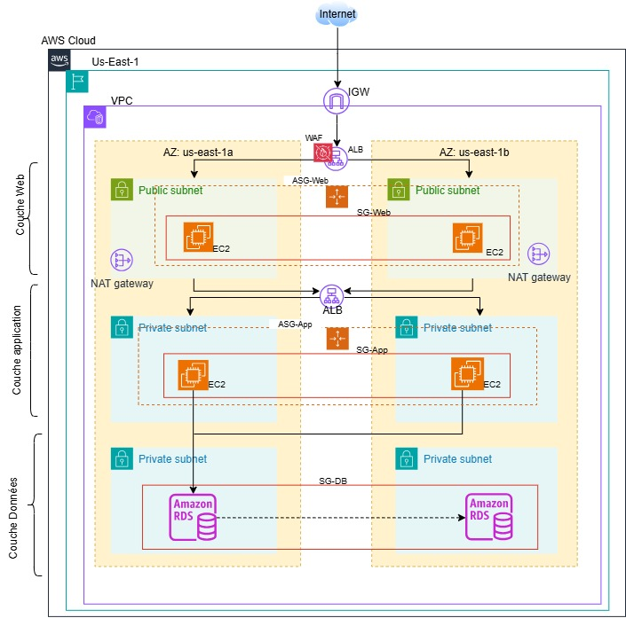

# Déploiement d'une architecture AWS 3-tiers avec Terraform

Infrastructure AWS à trois niveaux (web, applicatif, données) répartie sur deux zones de disponibilité et entièrement décrite avec Terraform.

## Sommaire

- [Contexte et objectifs](#contexte-et-objectifs)
- [Architecture](#architecture)
- [Services AWS utilisés](#services-aws-utilisés)
- [Sécurité](#sécurité)
- [Fiabilité et performance](#fiabilité-et-performance)
- [Mise en œuvre](#mise-en-œuvre)
- [Coûts et optimisation](#coûts-et-optimisation)
- [Résultats](#résultats)
- [Enseignements et évolutions](#enseignements-et-évolutions)

---

## Contexte et objectifs

Ce projet met en place une infrastructure AWS en architecture 3-tiers (web, applicatif, données), décrite et déployée entièrement avec Terraform, afin qu'elle soit hautement disponible, sécurisée et reproductible.

Objectifs, vérifiables dans le code :

- répartir chaque niveau sur deux zones de disponibilité ;
- séparer strictement les flux réseau entre les niveaux ;
- protéger l'entrée publique par un pare-feu applicatif (WAF) ;
- disposer d'une base de données relationnelle résiliente, avec sauvegardes automatiques sur 7 jours ;
- externaliser chaque paramètre variable (tailles d'instances, capacités, plages CIDR, rétention des journaux) pour adapter l'infrastructure à d'autres environnements (dev, staging, prod).

---

## Architecture

Le trafic traverse trois niveaux dupliqués sur deux zones de disponibilité, et seul l'ALB public est exposé à Internet.



Le chemin d'une requête : Internet Gateway, ALB public (protégé par le WAF), instances web, ALB interne, instances applicatives, puis base de données. La région par défaut est `us-east-1`.

### Plan d'adressage

| Sous-réseau | Niveau             | Zone | Plage CIDR     |
|-------------|--------------------|:----:|----------------|
| `public_1`  | Web (public)       | 1    | `10.0.1.0/24`  |
| `public_2`  | Web (public)       | 2    | `10.0.2.0/24`  |
| `app_1`     | Applicatif (privé) | 1    | `10.0.11.0/24` |
| `app_2`     | Applicatif (privé) | 2    | `10.0.12.0/24` |
| `data_1`    | Données (privé)    | 1    | `10.0.21.0/24` |
| `data_2`    | Données (privé)    | 2    | `10.0.22.0/24` |

Le VPC utilise la plage `10.0.0.0/16` ; toutes ces plages sont des variables Terraform.

### Routage

- Une table de routage publique, partagée par les deux zones, envoie le trafic par défaut vers l'Internet Gateway.
- Deux tables privées, une par zone, envoient le trafic par défaut vers la NAT Gateway de leur propre zone : la perte d'une zone n'affecte pas l'autre.
- Les sous-réseaux applicatifs et de données d'une zone partagent la même table privée : leurs instances peuvent donc sortir vers Internet par la NAT, sans qu'Internet puisse initier une connexion vers elles.

---

## Services AWS utilisés

L'infrastructure repose sur dix services ou composants AWS, tous créés par Terraform ; les valeurs ci-dessous sont celles par défaut du fichier de variables.

| Service | Rôle dans le projet | Réglage clé |
|---------|---------------------|-------------|
| VPC, Internet Gateway, NAT Gateway | Réseau isolé et sorties vers Internet | VPC `10.0.0.0/16`, six sous-réseaux, une NAT Gateway par zone |
| Application Load Balancer public | Point d'entrée unique depuis Internet | Écoute HTTP sur le port 80, sous-réseaux publics, contrôle de santé sur `/` |
| Application Load Balancer interne | Répartition du trafic vers le niveau applicatif | Port 8080, sous-réseaux applicatifs, contrôle de santé sur `/health` |
| AWS WAFv2 | Filtrage des attaques web sur l'ALB public | Quatre groupes de règles gérées AWS et une limitation de débit par IP |
| EC2 et Auto Scaling (web) | Niveau web | `t3.micro`, Amazon Linux 2023 avec Apache, 2 à 4 instances (2 souhaitées), sous-réseaux publics |
| EC2 et Auto Scaling (applicatif) | Niveau applicatif | `t3.micro`, 2 à 4 instances (2 souhaitées), sous-réseaux applicatifs |
| RDS MySQL 8.0 | Base de données relationnelle | `db.t3.micro`, 20 Go, Multi-AZ, stockage chiffré, sauvegardes sur 7 jours, non publique |
| Groupes de sécurité | Filtrage en cascade entre niveaux | Cinq groupes, un par composant |
| CloudWatch | Journaux du WAF et alarme | Rétention de 90 jours, alarme sur les requêtes bloquées |
| Systems Manager (paramètre SSM) | Image système toujours à jour | Dernière AMI Amazon Linux 2023 lue au déploiement |

---

## Sécurité

La sécurité repose sur une cascade de groupes de sécurité : chaque niveau n'accepte du trafic que depuis celui qui le précède, et seul l'ALB public reçoit du trafic d'Internet.

### Flux autorisés

| Source                 | Destination            | Port         |
|------------------------|------------------------|--------------|
| Internet               | ALB public             | 80 et 443    |
| ALB public             | Instances web          | 80           |
| Instances web          | ALB interne            | 8080         |
| ALB interne            | Instances applicatives | 8080         |
| Instances applicatives | Base de données        | 3306 (MySQL) |

Au-delà du premier flux, les règles désignent le groupe de sécurité du niveau précédent plutôt qu'une plage d'adresses : elles restent valables même si les adresses changent.

### Pare-feu applicatif (WAF)

Une Web ACL WAFv2 est associée à l'ALB public. Elle autorise le trafic par défaut et applique, dans l'ordre :

1. le jeu de règles commun AWS ;
2. le jeu des entrées malveillantes connues ;
3. le jeu de règles contre les injections SQL ;
4. la liste de réputation d'adresses IP d'Amazon ;
5. une règle de limitation qui bloque une IP au-delà de 2 000 requêtes sur 5 minutes (valeur par défaut, modifiable par variable).

Les journaux du WAF vont dans CloudWatch Logs avec une rétention de 90 jours, et une alarme se déclenche si plus de 100 requêtes sont bloquées sur 5 minutes.

### Données et secrets

- La base RDS n'est pas accessible publiquement, son stockage est chiffré et elle n'accepte que le groupe de sécurité du niveau applicatif.
- L'identifiant et le mot de passe de la base sont des variables marquées sensibles ; le mot de passe n'a pas de valeur par défaut et doit faire au moins 8 caractères. Il est fourni au moment du déploiement, jamais écrit dans le code.

---

## Fiabilité et performance

Chaque niveau est dupliqué sur deux zones de disponibilité, de sorte que la perte d'une zone laisse l'autre en service.

| Niveau           | Mécanisme de résilience |
|------------------|-------------------------|
| Entrée           | L'ALB public est déployé dans les deux sous-réseaux publics |
| Web              | Un groupe Auto Scaling réparti sur les deux sous-réseaux publics, minimum 2 instances |
| Applicatif       | Un ALB interne et un groupe Auto Scaling répartis sur les deux sous-réseaux applicatifs, minimum 2 instances |
| Sorties Internet | Une NAT Gateway par zone, avec sa propre table de routage |
| Données          | RDS Multi-AZ : une instance de secours dans l'autre zone, avec bascule automatique |

- **Sauvegardes** : sauvegardes automatiques conservées 7 jours, et instantané final conservé si la base est supprimée.
- **Contrôles de santé** : les groupes cibles interrogent `/` sur le niveau web et `/health` sur le niveau applicatif, et l'ALB n'envoie du trafic qu'aux instances saines.
- **Capacité** : chaque niveau est configuré avec un minimum de 2, un maximum de 4 et une capacité souhaitée de 2 instances. Aucune politique de mise à l'échelle automatique n'est définie : la capacité reste à 2 tant qu'elle n'est pas modifiée.
- **Remplacement des instances** : les groupes utilisent les contrôles de l'état EC2 ; une instance défaillante est donc remplacée, mais pas une instance qui échouerait seulement au contrôle de santé de l'ALB (voir les pistes d'amélioration).
- **Taille** : les instances `t3.micro` et la base `db.t3.micro` conviennent à une démonstration ; elles sont à redimensionner par variable pour une charge réelle.

---

## Mise en œuvre

Le code est découpé en huit fichiers, un par domaine fonctionnel, pour faciliter la lecture, la maintenance et les revues.

| Fichier        | Contenu |
|----------------|---------|
| `providers.tf` | Terraform 1.5.0 ou plus, fournisseur AWS en version 5.x, région, étiquettes par défaut, zones de disponibilité, AMI Amazon Linux 2023 lue dans SSM |
| `variables.tf` | Région, nom d'environnement, plages CIDR, paramètres du WAF, tailles et capacités des niveaux, paramètres de la base, avec une validation sur le mot de passe |
| `network.tf`   | VPC, Internet Gateway, six sous-réseaux, deux NAT Gateways, tables de routage |
| `security.tf`  | Cinq groupes de sécurité, Web ACL WAFv2, journaux et alarme |
| `web-tier.tf`  | ALB public, groupe cible, écouteur HTTP, modèle de lancement, groupe Auto Scaling, association du WAF |
| `app-tier.tf`  | ALB interne, groupe cible, écouteur sur le port 8080, modèle de lancement, groupe Auto Scaling |
| `database.tf`  | Groupe de sous-réseaux et instance RDS MySQL |
| `outputs.tf`   | Identifiants du VPC et des sous-réseaux, des NAT Gateways, ARN de la Web ACL, noms DNS des deux ALB, point d'accès et port de la base |

Toutes les valeurs variables sont des variables Terraform avec une valeur par défaut, sauf le mot de passe de la base. Un même code peut donc servir pour dev, staging et production en changeant `environment_name` et les tailles. Chaque ressource est nommée et étiquetée à partir de ce préfixe, avec l'étiquette `ManagedBy = terraform`.

### Déploiement

Le déploiement suit le flux Terraform standard, depuis le répertoire qui contient les fichiers `.tf`. Le mot de passe de la base est passé par une variable d'environnement :

```bash
export TF_VAR_db_password='<mot-de-passe-d-au-moins-8-caracteres>'
terraform init                # télécharge le fournisseur AWS
terraform plan -out=tfplan    # affiche le plan sans rien appliquer
terraform apply tfplan        # applique le plan validé
```

Pour supprimer l'environnement après une démonstration, `terraform destroy` retire toutes les ressources ; l'instantané final de la base est conservé.

### Extrait : la base de données

```hcl
multi_az                = true   # bascule automatique en cas de défaillance
backup_retention_period = 7      # sauvegardes automatiques sur 7 jours
storage_encrypted       = true   # chiffrement du stockage
publicly_accessible     = false  # aucune exposition à Internet
skip_final_snapshot     = false  # instantané final conservé à la suppression
```

Le bloc commenté dans `providers.tf` propose un état distant dans S3 avec verrouillage DynamoDB, recommandé dès que plusieurs personnes ou une production sont concernées.

---

## Coûts et optimisation

En fonctionnement permanent, la configuration par défaut coûte environ **186 $ par mois** avant trafic ; les NAT Gateways en représentent plus d'un tiers, et détruire l'environnement hors des périodes d'utilisation est le levier le plus efficace.

### Estimation des coûts

Hypothèses : région `us-east-1`, 730 heures par mois, tarifs à la demande relevés le 12 octobre 2026, configuration par défaut du fichier de variables, sans trafic.

| Poste | Calcul | Production (par défaut) | Test allégé |
|-------|--------|------------------------:|------------:|
| NAT Gateways | 0,045 $/h par passerelle | 65,70 $ (2) | 32,85 $ (1) |
| Load balancers (public et interne) | 0,0225 $/h chacun | 32,85 $ | 32,85 $ |
| RDS MySQL `db.t3.micro` | 0,017 $/h, doublé en Multi-AZ | 24,82 $ (Multi-AZ) | 12,41 $ (une zone) |
| Instances EC2 `t3.micro` | 0,0104 $/h par instance | 30,37 $ (4) | 15,18 $ (2) |
| Adresses IPv4 publiques | 0,005 $/h par adresse | 21,90 $ (6) | 14,60 $ (4) |
| WAF | 5 $ la Web ACL + environ 1 $ par règle | 10,00 $ | 10,00 $ |
| **Total mensuel** | | **environ 186 $** | **environ 118 $** |

Les six adresses IPv4 de la colonne Production se répartissent ainsi : deux pour les NAT Gateways, deux pour l'ALB public (une par zone) et deux pour les instances web, qui reçoivent une adresse publique dans les sous-réseaux publics.

Coûts variables non inclus : traitement des données par les NAT Gateways (0,045 $ par Go), capacités des load balancers (LCU), requêtes inspectées par le WAF (0,60 $ par million), stockage disque des instances et de la base, sauvegardes au-delà de l'espace inclus, journaux CloudWatch. Les tarifs proviennent de la page officielle du WAF et de sources tierces qui reprennent les tarifs AWS ; confirmez-les avec l'[AWS Pricing Calculator](https://calculator.aws/) avant de publier des montants.

### Suivi des coûts

- Le fournisseur AWS applique déjà les étiquettes `Environment` et `ManagedBy` à toutes les ressources : il suffit de les activer comme étiquettes de répartition des coûts dans la facturation pour suivre ce projet dans Cost Explorer.
- Un budget AWS Budgets avec alerte à 80 % et 100 % protège contre un oubli, ce qui compte ici car les coûts fixes courent même sans trafic.

### Solutions de réduction, avec leur compromis

| Levier | Effet | Compromis |
|--------|-------|-----------|
| Détruire l'environnement hors démonstration (`terraform destroy`) | Supprime tous les coûts fixes ; l'instantané final de la base reste conservé | Il faut recréer l'environnement avant chaque utilisation |
| Une seule NAT Gateway en test | Économise environ 33 $ par mois | Plus aucune redondance sur les sorties Internet, et du trafic entre zones |
| RDS en une seule zone en test | Divise par deux le coût de la base | Pas de bascule automatique |
| Une instance par niveau en test (`web_min_size`, `app_min_size`) | Économise la moitié du coût EC2 | Aucune redondance dans le niveau |
| Savings Plans en production | Environ 28 % de moins sur une instance `t3.micro` avec un engagement d'un an | Engagement sur la durée |
| Retirer la route vers la NAT des sous-réseaux de données | Réduit le trafic traité par la NAT et la surface d'exposition | La base ne peut plus joindre Internet, ce qui n'est pas nécessaire pour RDS |
| Points de terminaison VPC | Le point de terminaison S3 de type passerelle est gratuit et évite du trafic NAT | Les points de terminaison de type interface sont facturés à l'heure |
| Instances web en sous-réseaux privés | Supprime deux adresses IPv4 publiques et réduit l'exposition | Leur sortie passe par la NAT |
| Rétention des journaux WAF à 30 jours (`log_retention_in_days`) | Réduit le stockage CloudWatch | Historique plus court |

### Compromis coût et résilience

Le projet choisit de payer la haute disponibilité : deux NAT Gateways, une base Multi-AZ et deux instances par niveau représentent environ 68 $ par mois de plus que le profil de test. Ce choix se défend en production, mais pas pour un environnement de démonstration, d'où l'intérêt d'externaliser ces paramètres en variables.

---

## Résultats

Le code et l'état Terraform confirment un déploiement complet de l'architecture : 46 ressources gérées, réparties sur deux zones, avec les paramètres de résilience attendus.

| Point vérifié | Constat | Source |
|---------------|---------|--------|
| Ressources déployées | 46 ressources gérées et 3 sources de données | Sauvegarde de l'état Terraform |
| Répartition par niveau | Deux sous-réseaux par niveau, un dans chaque zone | `network.tf` |
| Base de données | MySQL 8.0, Multi-AZ, stockage chiffré, sauvegardes sur 7 jours, non publique | État Terraform et `database.tf` |
| Capacité des niveaux | Web et applicatif : 2 à 4 instances, 2 souhaitées | État Terraform (groupes Auto Scaling) |
| Exposition à Internet | Un seul point d'entrée : l'ALB public, derrière le WAF | `security.tf` et `web-tier.tf` |
| Sorties produites | 10 sorties : VPC, sous-réseaux, NAT Gateways, Web ACL, noms DNS des ALB, point d'accès de la base | `outputs.tf` |
| Fin de vie | L'état courant ne contient plus aucune ressource : l'environnement a été détruit après les essais | `terraform.tfstate` |

Ces constats portent sur la configuration et l'état Terraform. Les fichiers fournis ne contiennent aucune mesure de performance, de charge ou de bascule : ajoutez-en (test de charge, exercice de bascule Multi-AZ) pour étayer les objectifs de disponibilité.

---

## Enseignements et évolutions

Le projet atteint son objectif de base, mais la lecture du code laisse huit points à durcir avant une utilisation en production.

### Enseignements

- Décrire l'infrastructure en code la rend reproductible, traçable par le contrôle de version et réplicable sur d'autres environnements (dev, staging) ou d'autres régions pour la reprise après sinistre.
- Externaliser les paramètres en variables permet d'adapter le même code à plusieurs environnements, et de réduire fortement le coût d'un environnement de test.
- Chaîner les groupes de sécurité plutôt que filtrer par plages d'adresses rend les règles lisibles et robustes.
- Planifier un exercice périodique de bascule Multi-AZ et un test de charge du WAF entretient la confiance dans la résilience de la plateforme.

### Limites constatées et pistes d'amélioration

| Limite constatée dans le code | Piste d'amélioration |
|-------------------------------|----------------------|
| L'état local `terraform.tfstate` contient le mot de passe de la base en clair | Il est désormais exclu du dépôt par le `.gitignore` ; activer l'état distant chiffré du bloc commenté de `providers.tf`, et laisser RDS gérer le mot de passe dans Secrets Manager |
| L'ALB public n'a qu'un écouteur HTTP, alors que le groupe de sécurité ouvre déjà le port 443 | Ajouter un écouteur HTTPS avec un certificat ACM et rediriger le port 80 vers 443 |
| Le modèle de lancement du niveau applicatif écrit seulement un fichier de journal : rien n'écoute sur le port 8080 ni sur `/health` | Déployer l'application (image, script de démarrage ou conteneur) pour que les contrôles de santé réussissent |
| Les groupes Auto Scaling utilisent le contrôle EC2 et n'ont aucune politique de mise à l'échelle | Passer le contrôle de santé en mode ELB et ajouter une politique de suivi de cible (CPU ou requêtes par cible) |
| Les sous-réseaux de données sont routés vers la NAT Gateway, alors que le code les décrit comme isolés | Leur donner une table de routage sans route par défaut |
| Tous les groupes de sécurité laissent sortir tout le trafic | Restreindre le trafic sortant aux destinations nécessaires |
| Les instances web ont une adresse publique et aucun moyen d'administration (ni clé SSH, ni profil d'instance) | Les placer en sous-réseaux privés et leur associer un profil d'instance pour Systems Manager Session Manager |
| L'instantané final de la base porte un nom fixe : une seconde suppression échouera si cet instantané existe déjà | Utiliser un identifiant horodaté |

### Évolutions

- Automatiser `terraform plan` et `terraform apply` dans un pipeline CI/CD, avec revue des changements avant application.
- Séparer les environnements avec des fichiers de variables ou des espaces de travail Terraform.
- Ajouter un nom de domaine (Route 53) et du HTTPS de bout en bout.
